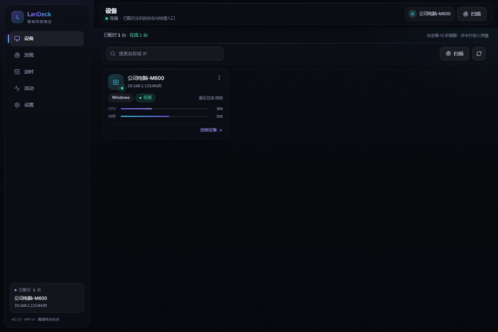
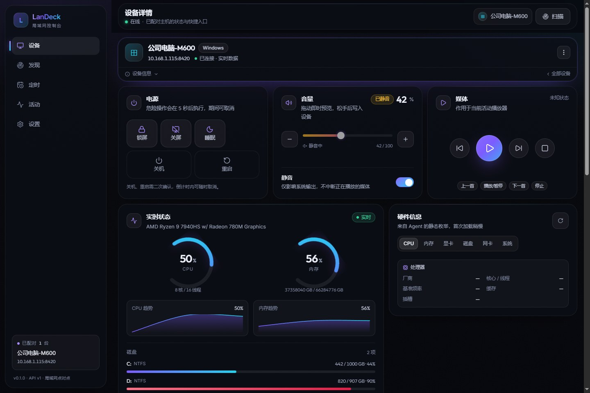
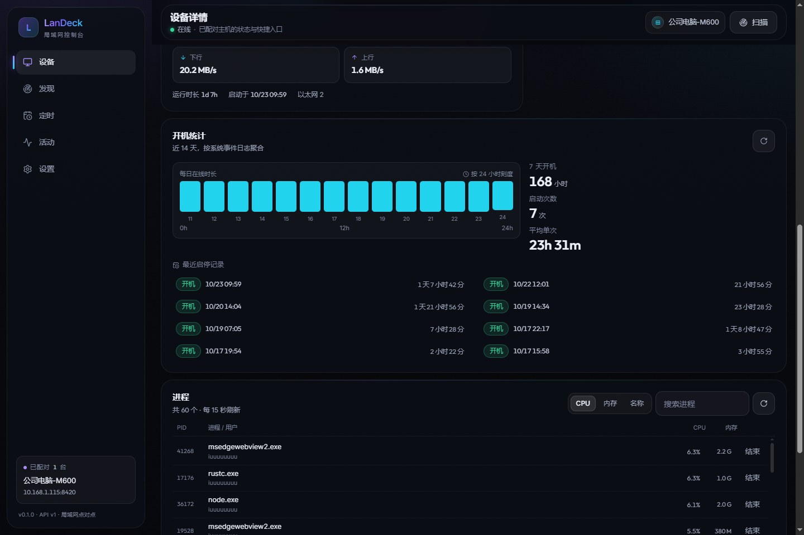
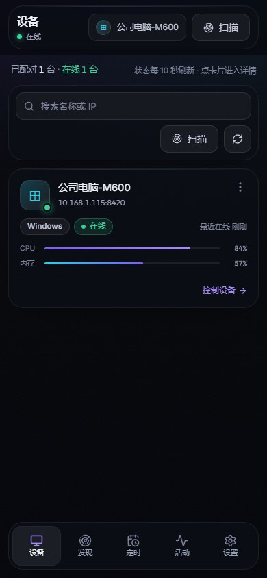
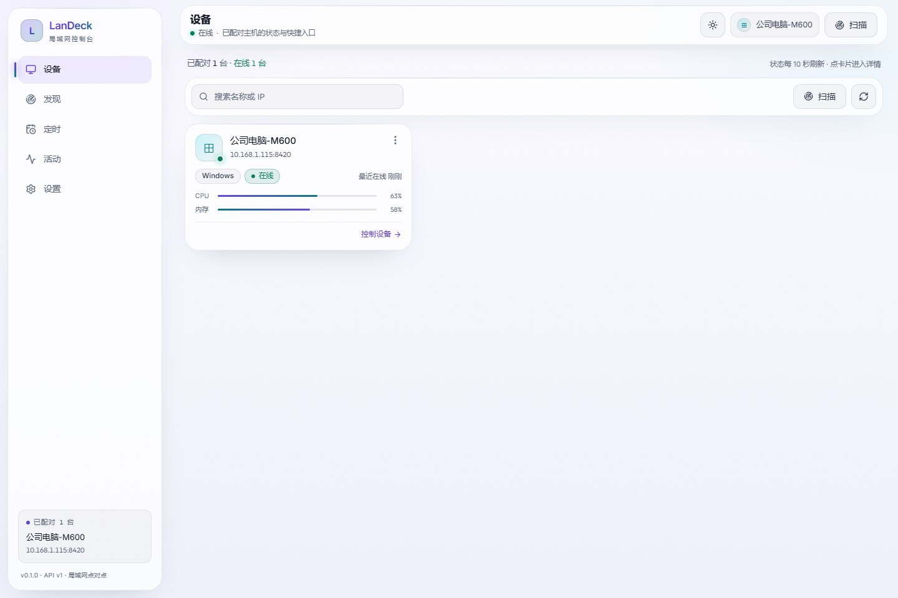
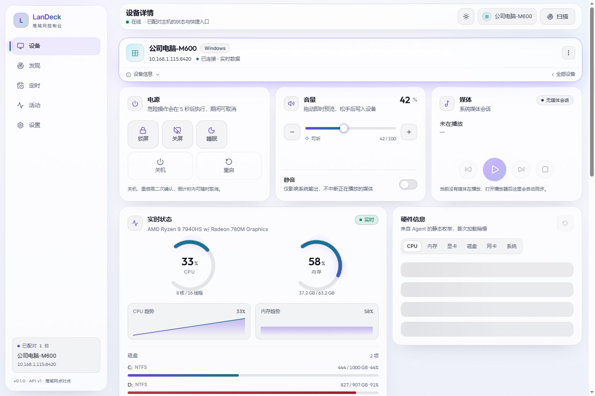

# LanDeck · 局域网 PC 控制台

[](https://github.com/iuuuuuuuu/landeck/actions/workflows/build.yml)
[](https://github.com/iuuuuuuuu/landeck/releases)
[](LICENSE)

> 在手机或另一台电脑上，控制局域网里的 PC：开关机、重启、睡眠、定时任务、音量、媒体播放；
> 查看硬件、运行状态、开机统计、进程，并能结束进程。
> **一个 10 MB 的 Go 单文件 Agent + 一份 React 界面**，没有 Electron，没有 Chromium 副本。


```
┌── 控制端 ─────────────────────────────────────────┐
│ Tauri v2 壳（Win/macOS/Linux/Android，复用系统 WebView）│
│ 或直接浏览器打开 http://<主机名>.local:8420          │
└───────────────────────┬───────────────────────────┘
                        │ HTTP/JSON + WebSocket（局域网，可开 TLS）
                        │ 配对：固定密钥 / 6 位随机码
┌───────────────────────┴───────────────────────────┐
│ LanDeck Agent（Go，单文件 ~10 MB，常驻 ~30 MB）      │
│  httpapi  ├ REST + WS + 内嵌 Web UI                 │
│           ├ /mcp  →  MCP 工具面（AI 可调用）         │
│  discovery├ mDNS（xxx.local）+ UDP 8421 广播         │
│  control  ├ 电源/音量/媒体/进程（平台分支）           │
│  metrics  ├ 实时状态/硬件/开机历史（gopsutil + 系统命令）│
│  scheduler└ 定时任务 + RTC 唤醒                      │
└───────────────────────────────────────────────────┘
```

## 桌面形态

Windows 版 Agent 是**托盘程序**（`-H windowsgui`，双击不弹黑框）：

- 托盘菜单：打开控制台 / 复制配对码 / 已配对台数 / **开机自启**（勾选即注册登录启动任务）/ 打开数据目录 / 退出
- 首次运行会自动打开浏览器里的控制台，屏幕上直接能看到 6 位随机码
- 日志写到 `data/agent.log`（超过 2 MB 自动轮转）
- 需要看控制台输出的排障场景，用同包的 `landeck-agent-windows-amd64-console.exe`

界面支持**深色 / 浅色 / 跟随系统**三套主题，顶栏一键切换，设置页也能选，选择会记住。

## 界面

浅色 / 深色两套主题，跟随系统或手动切换。

| 设备列表 | 设备详情 |
| --- | --- |
|  |  |

| 硬件 / 开机统计 / 进程 | 手机端 |
| --- | --- |
|  |  |

| 浅色主题 · 设备列表 | 浅色主题 · 设备详情 |
| --- | --- |
|  |  |

## 下载安装（普通用户）

到 [Releases](https://github.com/iuuuuuuuu/landeck/releases) 下载：

| 系统 | 文件 | 说明 |
| --- | --- | --- |
| Windows（被控端） | `landeck-agent-windows-amd64.exe` | 双击即跑，控制台会打印密钥与随机码 |
| Linux amd64 / arm64 | `landeck-agent-linux-*` | `chmod +x` 后运行 |
| macOS Intel / Apple Silicon | `landeck-agent-darwin-*` | `chmod +x` 后运行（首次需在「隐私与安全性」放行） |
| Windows（控制端） | `LanDeck_*_x64-setup.exe` / `.msi` | 图形界面的 App |
| Android | `LanDeck-1.0.1-android.apk` | 直连安装（自签名，安装时需允许「未知来源」） |
| 任意设备 | 浏览器打开 `http://<被控机IP>:8420` | 零安装，手机也能用 |

控制端 App 打开后点「扫描」→ 选设备 → 输入被控机控制台里的固定密钥或 6 位随机码即可。
（同一个局域网、被控机放行 8420/8421 端口。）

## 快速开始（从源码）

```bash
# 1. 构建前端并嵌进 Agent（产物 web/dist → agent/internal/webui/dist）
pnpm --dir web install
pnpm --dir web build
cp -r web/dist/. agent/internal/webui/dist/

# 2. 编译 Agent（当前平台）
cd agent && go build -ldflags "-s -w" -o bin/landeck-agent .
./bin/landeck-agent --data ./data          # 控制台会打印固定密钥与随机码
```

打开 `http://<本机IP>:8420` → 点「扫描」→ 选设备 → 输入固定密钥或屏幕上显示的 6 位随机码 → 开始控制。

常用参数：

| 参数 | 说明 |
| --- | --- |
| `--data <dir>` | 数据目录（配置/日志/定时任务），默认与可执行文件同级 `data/` |
| `--port 8420` | 覆盖 HTTP 端口 |
| `--name "书房电脑"` | 覆盖设备显示名 |
| `--dry-run` | 演练：不真正关机、不发媒体键（音量仍真实可调） |
| `--no-mdns` | 关闭 mDNS 广播 |
| `install` / `uninstall` / `status` | 注册开机自启（Windows 计划任务 / systemd user unit / LaunchAgent） |
| `mcp --token ldk_…` | stdio 模式的 MCP 桥，供 Claude Desktop 之类的客户端拉起 |

## 目录

```
agent/               Go Agent（REST + WS + MCP + 内嵌 UI）
  internal/config    配置与客户端令牌（原子落盘）
  internal/auth      固定密钥/随机码配对、限流、吊销
  internal/control   电源/音量/媒体（windows / linux / darwin 各一份实现）
  internal/metrics   实时状态、硬件、开机历史、进程
  internal/scheduler 定时任务 + RTC 唤醒
  internal/discovery mDNS + UDP 广播
  internal/httpapi   HTTP 路由、WS、MCP、静态站点
web/                 React 19 + TS + Tailwind v4 + framer-motion 的控制端界面
app/                 Tauri v2 壳（窗口 + 原生 UDP 扫描 + 图标）
docs/API.md          接口契约（唯一事实来源）
docs/PLAN.md         技术方案与体积/性能预算
tools/               视觉截图与前端冒烟脚本（无第三方依赖，走 CDP）
.agents/notes/       决策笔记（agent-notes 规范 + 校验门禁）
```

## 端口

| 端口 | 用途 | 协议 |
| --- | --- | --- |
| 8420 | HTTP API + Web UI + `/mcp` | HTTP/1.1、WebSocket |
| 8421 | 局域网发现 | UDP 广播 |
| 8443 | 可选 TLS（`settings.tls`） | HTTPS |

## 配对与安全

- **固定密钥**：首次启动生成（如 `7K9F-2M4Q`），可在设置里更换，长期有效。
- **随机码**：6 位数字，默认 300 秒轮换，只显示在被控机控制台 / 本机界面。适合临时设备，泄露窗口极短。
- 配对成功后下发 `ldk_…` 令牌，服务端只存 SHA-256；每个客户端可单独吊销、单独换发。
- 配对接口每 IP 每分钟限 10 次；令牌失效直接 401，前端会提示重新配对。
- 角色：首个配对客户端为 `owner`，其余 `controller`（当前版本 owner 与 controller 权限一致，viewer 预留给只读场景）。

## MCP（给 AI 用的工具面）

Agent 内置 MCP 服务（JSON-RPC 2.0 over HTTP），AI 客户端可直接调用这 10 个工具：

`landeck_status`、`landeck_power`、`landeck_volume`、`landeck_media`、`landeck_hardware`、
`landeck_uptime`、`landeck_schedules`、`landeck_processes`、`landeck_kill_process`、`landeck_activity`

```bash
curl -X POST http://127.0.0.1:8420/mcp \
  -H "Authorization: Bearer ldk_xxx" -H 'Content-Type: application/json' \
  -d '{"jsonrpc":"2.0","id":1,"method":"tools/call",
       "params":{"name":"landeck_power","arguments":{"op":"sleep"}}}'
```

Claude Desktop 等 stdio 客户端用桥接模式：

```bash
landeck-agent mcp --host 127.0.0.1 --port 8420 --token ldk_xxx
```

## 平台支持

| 能力 | Windows | Linux | macOS |
| --- | --- | --- | --- |
| 关机/重启/注销 | ✅ | ✅ | ✅（走 System Events） |
| 睡眠 | ✅ | ✅（systemctl） | ✅（pmset） |
| 休眠 | 需系统开启休眠 | ✅（若内核支持） | ➖ 不支持 |
| 锁屏 / 关屏 | ✅（SendMessage 关显示器） | ✅（xset/wlopm/sway） | ✅ |
| 音量 | ✅ Core Audio（COM，1–20ms） | ✅ wpctl/pactl/amixer | ✅ osascript |
| 媒体键 | ✅ SendInput | ✅ playerctl | ✅ nowplaying-cli（未装则 Music.app） |
| RTC 定时唤醒 | ✅ 计划任务 WakeToRun | ⚠️ 需 root（rtcwake） | ⚠️ 需管理员（pmset） |
| 开机统计 | ✅ 事件日志 6005/6006 | ✅ `last -x` | ✅ `last` |
| 进程查看/结束 | ✅ | ✅ | ✅ |

不支持的能力会在 `/system.capabilities` 里报 false，前端自动隐藏对应按钮。

## 开发

```bash
pnpm --dir web dev            # 前端：http://localhost:5199（/api 代理到 8420）
cd agent && go run . --dry-run --data ./data

node tools/visual-check.mjs --base http://<ip>:8420   # 截图到 .tmp/shots
node tools/smoke.mjs --base http://<ip>:8420          # 前端冒烟（真浏览器 + 真 Agent）
npm run verify-notes                                  # 决策笔记门禁
```

## 打包

```bash
tools/build.sh                 # 三平台 Agent + 前端 → agent/dist/
cd app && pnpm install && pnpm tauri build            # 安装包（msi/nsis/dmg/deb/AppImage/apk）
```

体积预算（构建后用 `ls -la` 核对）：Agent 三平台均 ≤ 15 MB；前端 gzip ≤ 300 KB；Tauri 安装包 ≤ 6 MB。

## 已知限制

- Linux 的精简发行版需要 WebKitGTK 才能跑 Tauri 壳；纯浏览器入口不受影响。
- Linux/macOS 的 RTC 唤醒需要 root/管理员权限，未提权时会在日志里明确报错。
- macOS 媒体键若未安装 `nowplaying-cli`，只对 Music.app 生效。
- 浏览器端扫描依赖被控端 CORS 放行；AP 隔离/VLAN 环境下扫不到时用「手动添加 IP:PORT」。
- 令牌保存在控制端的 localStorage（Tauri 壳同源隔离），暂未接系统钥匙串。
